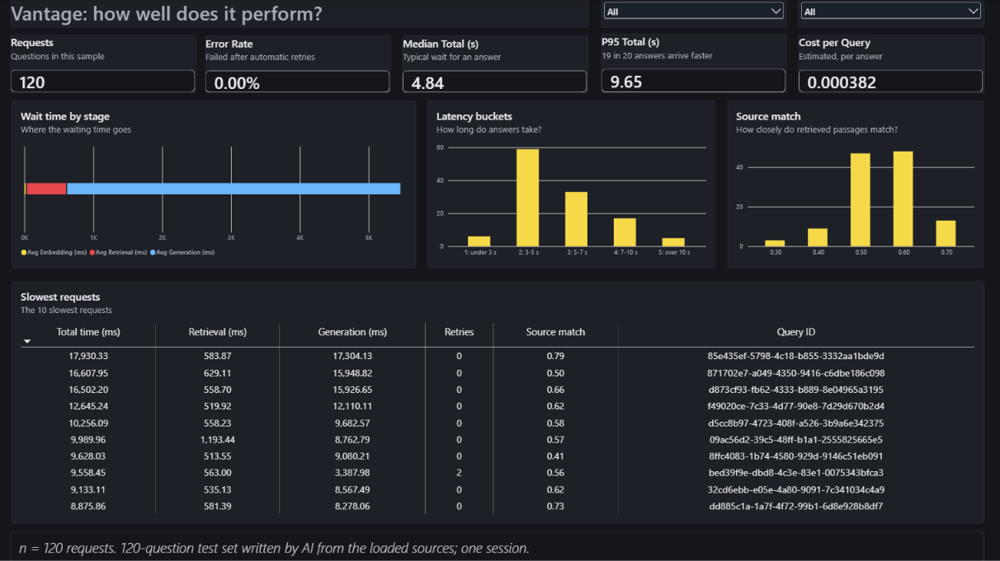
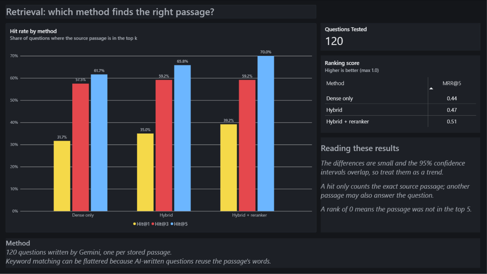
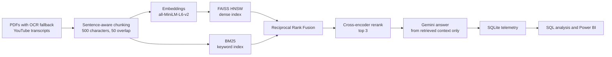

# Vantage

Ask questions about your own PDFs and YouTube videos and get answers grounded in those sources. Every query is logged to a SQL table, so the system can be measured for retrieval quality, speed, cost and reliability, and the results are shown in a Power BI dashboard.

<!-- TODO: add a screenshot of the app here, e.g.  -->
<!-- TODO: add the 60-90 second demo video link here -->

## Results at a glance

Measured on 120 test questions in one session (see [Limits](#limits-read-before-quoting-these-numbers)).

| Metric | Result |
|---|---|
| Failed requests (after automatic retries) | 0 of 120 |
| Requests that needed a retry | 5 of 120 (4.2%), all recovered |
| Median time to answer | 4.84 s |
| P95 time to answer | about 9.6 s |
| Share of the wait spent in the Gemini call | about 87% |
| Estimated cost per answer | $0.00038 ($0.046 for all 120) |
| Answered rather than "I don't know" | 92% |
| Correct passage in the top 3 results | 59% |

**Retrieval quality**: how often the passage a question was written from appears in the top k results (95% confidence interval in brackets).

| Method | Hit@1 | Hit@3 | Hit@5 | MRR@5 |
|---|---|---|---|---|
| Dense only | 32% (24-40) | 57.5% (49-66) | 62% (53-70) | 0.44 |
| Hybrid (dense + keyword) | 35% (27-44) | 59% (50-68) | 66% (57-74) | 0.47 |
| Hybrid + reranker (what the app uses) | 39% (31-48) | 59% (50-68) | 70% (61-77) | 0.51 |

The intervals overlap, so read this as a trend in favour of the reranker, not a proven gain.

## What the data says

- **The language model is the bottleneck, not search.** About 87% of the wait is the Gemini call. Retrieval takes roughly 0.6 s and embedding about 20 ms.
- **Retries cost real time.** Requests with no retry averaged 5.5 s. Those with one retry averaged 7.0 s (4 requests), and the one request with two retries took 9.6 s.
- **A few answers rest on weak matches.** 6 of 120 answers (5%) had a source match below 0.45. That threshold is a starting guess: no answers have been rated yet, so it can't be checked against user feedback.
- **Hybrid search plus a reranker helped at every k.** Hit@1 went from 32% to 39% and Hit@5 from 62% to 70%, with the caveat above.

## Dashboard

Built in Power BI Desktop from a star schema exported from the telemetry database (Power BI has no native SQLite connector, so `export_for_powerbi.py` writes CSVs). The file is `vantage_dashboard.pbix`.

**Page 1: Is Vantage reliable, fast and affordable?** Request count, error rate, median and P95 time, cost per query, where the waiting time goes, how long answers take, how closely retrieved passages match, the 10 slowest requests, and filters.

**Page 2: Does it find the right passage?** Hit rate at 1, 3 and 5 for each retrieval method, plus MRR@5.





Every metric has one definition, shared by the SQL, the Power BI measures and this page: [`docs/kpi_definitions.md`](docs/kpi_definitions.md). The build spec is [`docs/dashboard_spec.md`](docs/dashboard_spec.md).

To rebuild the dashboard without exposing real questions, run `python export_for_powerbi.py --sample`. It writes anonymised CSVs to `sample_data/`.

## How it works



- **Chunking:** sentence-aware and recursive, 500 characters with 50 overlap.
- **Retrieval:** dense search (FAISS HNSW) and keyword search (BM25) are merged with Reciprocal Rank Fusion, then a cross-encoder reranks to the top 3.
- **Reranker choice:** `cross-encoder/ms-marco-MiniLM-L-6-v2`, a much smaller model than the large rerankers I considered, chosen so a query stays fast on a CPU.
- **Generation:** Gemini, with a prompt that restricts the answer to the retrieved context. Each answer shows a source match score, which is how closely the best retrieved passage matches the question.
- **Telemetry:** every question is logged, including failures, with embedding, retrieval, generation and end-to-end time, retries, token counts, estimated cost and optional thumbs up or down.

## SQL analysis

`sql/analysis.sql` holds seven queries; run them all with:

```
python sql/run_analysis.py eval_telemetry.db
```

1. Headline KPIs
2. Where the waiting time goes
3. Daily trend with rolling averages
4. Does a low match score predict a bad answer?
5. What the slowest requests look like
6. What fails, and how often
7. What retries cost the user

## Evaluation

`eval/` contains the test set and results:

- `questions.json`: 120 questions written by Gemini from 7 of the loaded sources, one per stored passage, so the correct passage is known.
- `results_retrieval.md` and `results_full.md`: retrieval comparison and full-pipeline results.

Hit@k means the passage a question was written from appears in the top k results. MRR@5 scores 1 divided by the rank of that passage, and 0 if it is not in the top 5.

## Limits: read before quoting these numbers

- **One session, 120 questions.** Every figure is a rough estimate and comes with its sample size.
- **AI-written questions.** They tend to reuse the passage's own words, which can flatter keyword search. Compare the methods with each other and don't treat the percentages as absolute accuracy.
- **Strict hit definition.** A hit counts only the exact source passage. Another passage may also answer the question.
- **Answer correctness is not measured.** The evaluation checks whether the right passage was found, not whether the final answer was right.
- **No user ratings yet.** The helpful-rate metric is built but not reported, and the 0.45 low-confidence threshold is not validated.
- **Cost is an estimate** from token counts and the model's published price (in `telemetry.py`).
- **P95 differs slightly by tool:** about 9.6 s (Power BI 9.65, SQL 9.63) because each interpolates the percentile differently. The wait-time chart shows embedding, retrieval and generation only, so it leaves out the roughly 2.5% spent on prompt building and retry waits.

## Run it locally

Requires Python and a Gemini API key. Windows PowerShell:

```
git clone https://github.com/sAryan6394/vantage.git
cd vantage
python -m venv .venv
.\.venv\Scripts\Activate.ps1
pip install -r requirements.txt
```

Create a file named `.env` in the project folder and add your own Gemini API key. It stays on your machine, so never commit it:

```
GOOGLE_API_KEY=your-key-here
```

Optional settings in the same file:

- `TESSERACT_CMD`: the path to `tesseract.exe`, if the OCR fallback for scanned PDFs can't find Tesseract on your PATH.
- `TELEMETRY_DB_PATH`: where the telemetry database is stored (default `rag_telemetry.db`).

Then start the app:

```
streamlit run app.py
```

## Project layout

| Path | What it does |
|---|---|
| `app.py` | Streamlit app and UI |
| `rag_pipeline.py` | The pipeline shared by the app and the evaluation |
| `ingestion.py` | PDF, OCR and YouTube extraction, and chunking |
| `vector_store.py` | FAISS HNSW index |
| `hybrid_search.py` | BM25 and dense search merged with Reciprocal Rank Fusion |
| `reranker.py` | Cross-encoder reranking |
| `telemetry.py` | SQLite schema and query logging |
| `export_for_powerbi.py` | Exports the telemetry to a star schema for Power BI |
| `sql/` | Analysis queries and the script that runs them |
| `eval/` | Test questions, evaluation scripts and results |
| `docs/` | KPI definitions, dashboard spec and the Power BI theme |
| `sample_data/` | Anonymised export for the dashboard |

## Next steps

- Rate a sample of answers by hand to check answer quality and validate the low-confidence threshold.
- Collect more than one session of telemetry so trends over time mean something.
- Deploy a hosted demo.